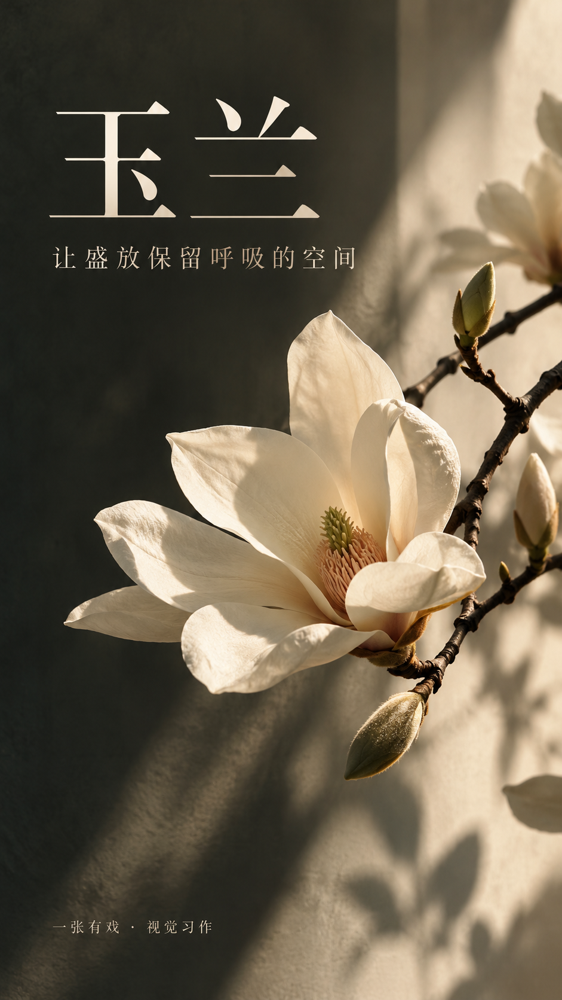
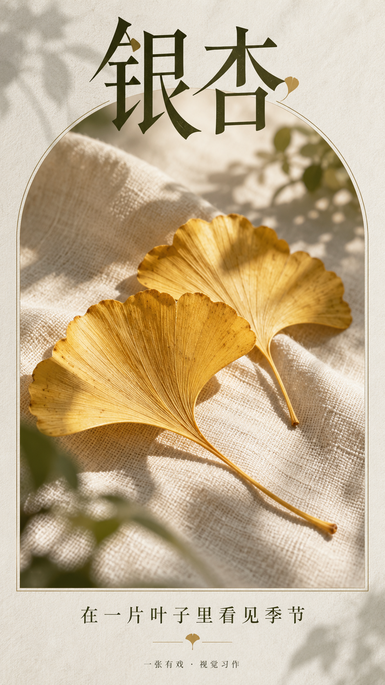
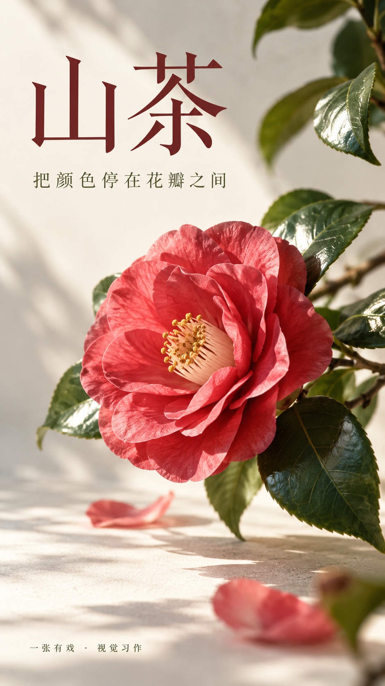
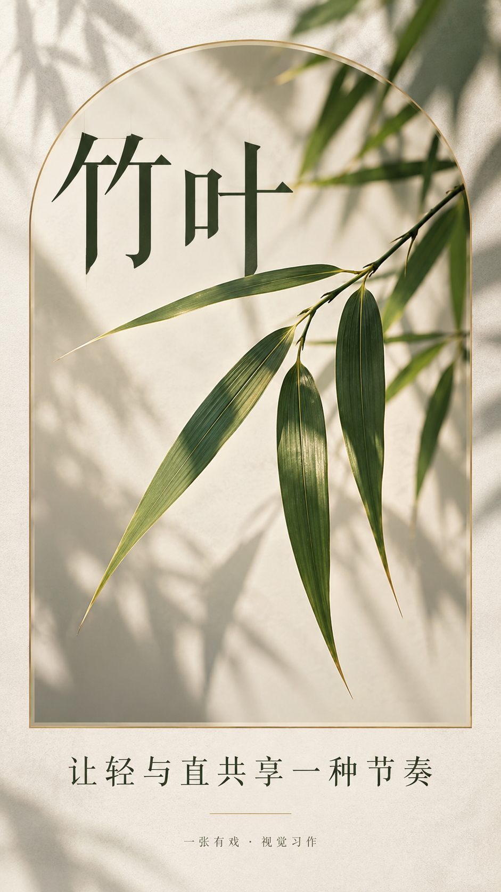
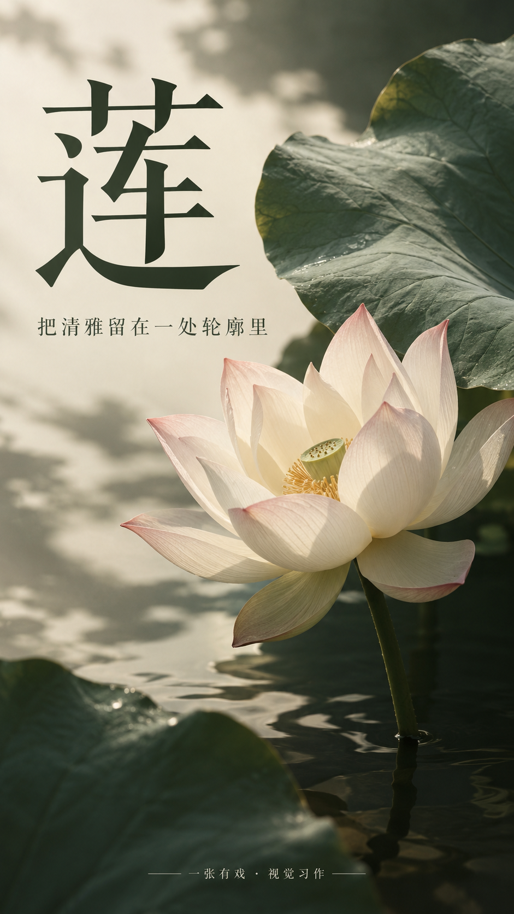
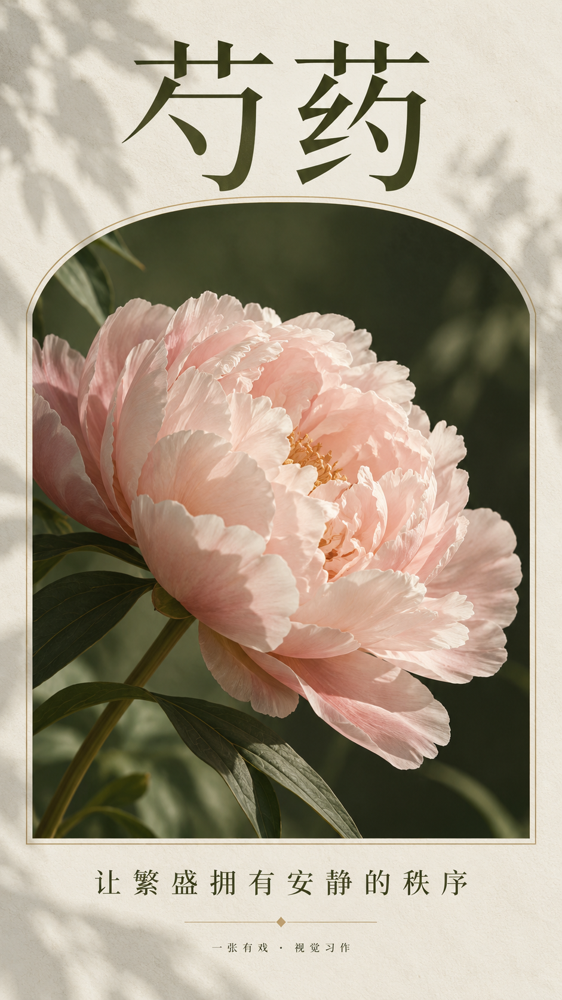
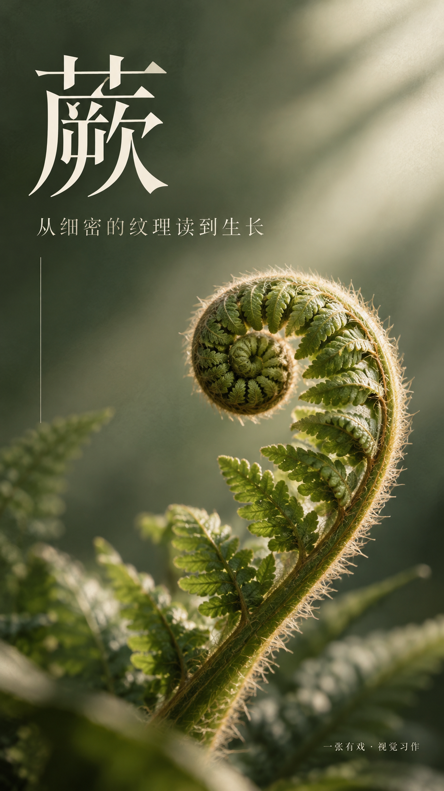
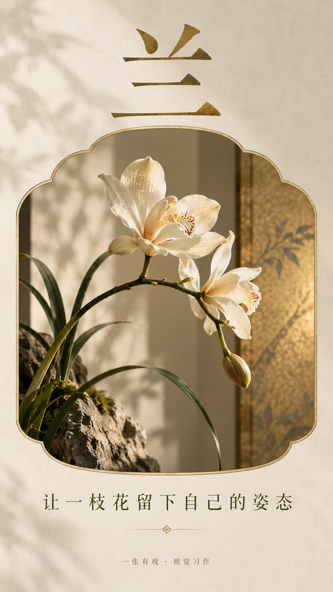

# 植物轻奢 · Botanical Premium Poster Skill

一张有戏「植物轻奢」风格中文海报技能。9:16 竖版，主标题 + 短句 + 页脚，简洁可控。

A poster-generation skill for the **botanical premium** style by 一张有戏 (EricChan): 9:16 portrait, Simplified Chinese, one headline, one supporting line.

## 作品展示 · Gallery

<table>
<tr><td align="center"><br>玉兰</td><td align="center"><br>银杏</td><td align="center"><br>山茶</td></tr>
<tr><td align="center"><br>竹叶</td><td align="center"><br>莲</td><td align="center"><br>芍药</td></tr>
<tr><td align="center"><br>蕨</td><td align="center"><br>兰</td></tr>
</table>

## 使用 · Usage

填入字段即可生成一张海报（只给主标题也能用）：

```
【主标题】：
【短句】：
【场景】：
【版式】：
【主色强调】：
【画幅】：9:16
```

详见 [SKILL.md](SKILL.md)、[prompt.md](prompt.md)；示例见 [examples/themes.md](examples/themes.md)；完整样例提示词：[PROMPTS.json](PROMPTS.json)。小红书配文：[XIAOHONGSHU_COPY.md](XIAOHONGSHU_COPY.md)。


## 来源 · Credits
Adapted from [howardz27/poster-generator-skill](https://github.com/howardz27/poster-generator-skill) (MIT, © 2026 yinnhao). See [SOURCES.md](SOURCES.md).

## License
MIT © 2026 EricChan (ericchan916)
